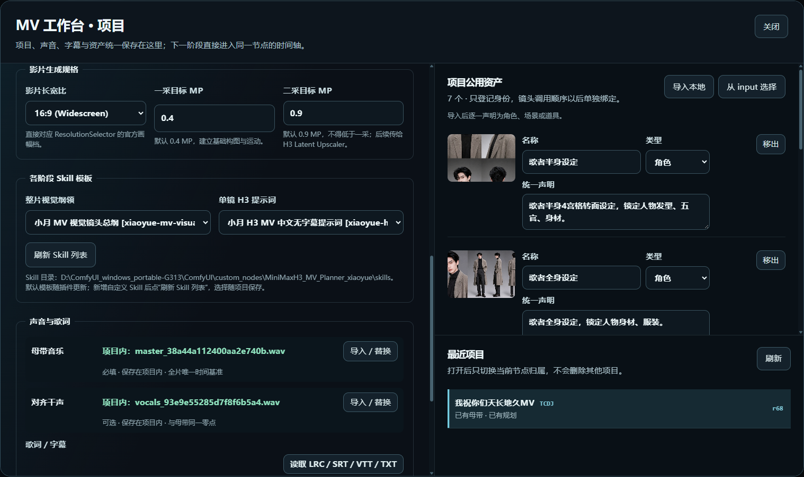
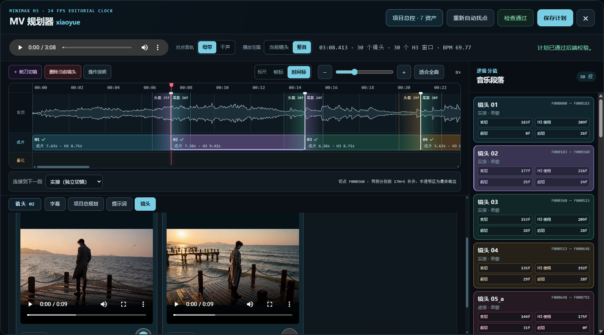
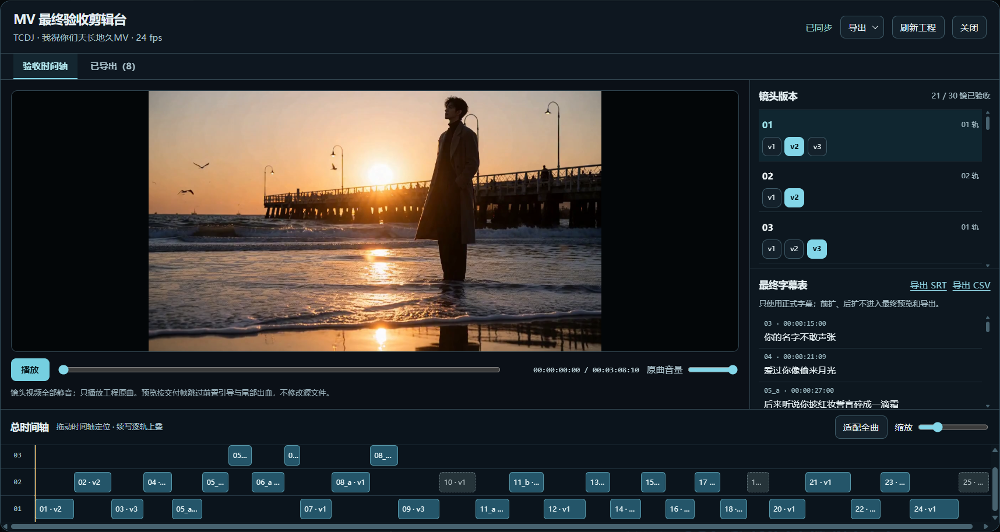

# MiniMax H3 MV 工作台 · xiaoyue

[English](README_EN.md) · [更新记录](CHANGELOG.md) · [特别感谢](ACKNOWLEDGEMENTS.md)

从一首歌到一支可验收的 MV，最难的往往不是生成某一个镜头，而是让歌词、节奏、素材、提示词、续写关系和几十次生成结果始终对得上。**MiniMax H3 MV 工作台 · xiaoyue** 把这些工作集中到 ComfyUI：用同一个主节点管理项目资料、原曲、歌词、资产、24 fps 分镜时间轴、两阶段 AI 提示词、逐镜生成版本和最终验收。

工作台负责**规划、组织和驱动**，通过可见连线输出每镜参数；模型、采样、LoRA、放大和保存节点仍由你在下游工作流中选择、接线和调整。仓库只提供插件、两个默认 Skill 和一个可编辑的 MiniMax H3 样例工作流，**不包含模型、歌曲或成片素材**。

当前插件版本：**v0.1.0 私有预览版**。样例工作流文件名中的 `v1.0` 是工作流模板修订号，不等于插件版本。

## 三个工作台

以下为实际项目的界面示意；截图里的歌曲与素材不包含在仓库中。

### ① 项目设定

### ② MV 工作台

### ③ 最终验收剪辑台

- **项目设定**：保存画幅、一／二采目标 MP、原曲、可选零点对齐干声、歌词／字幕和公共资产。项目文件保存在 ComfyUI 的 `input/xiaoyue_mv_projects/`，不写入插件仓库。
- **MV 工作台**：按母带节奏规划镜头，在 24 fps 绝对帧时间轴上调整硬切、续写与叠化；校正歌词、绑定镜头资产、生成整片纲领和单镜 H3 提示词，再逐镜或按选择顺序生成视频。每次成功生成保留独立版本与当时的帧点、种子和续写父版本关系。
- **最终验收剪辑台**：选定每镜版本，按版本自己的帧点预览完整 MV；分段视频静音，预览使用原曲。可导出无字成片＋SRT，或包含完整源片、相对路径素材、切点标记的 FCP7 XML 工程包。工程包目标是 Premiere 的 FCP7 XML 导入；剪映是否可用取决于其版本和导入链路，不能把 XML 当作剪映原生草稿。

## 从原曲到成片

1. **建立项目**：导入原曲、歌词／字幕和角色、场景等资产，设定画幅与采样目标。
2. **规划镜头**：沿 24 fps 绝对帧时间轴划分镜头、调整切点和连接方式，让整片纲领与单镜提示词使用同一份计划。
3. **生成与挑选**：通过用户工作流逐镜生成，保留各次成功生成的版本、种子、当时的帧点和续写父版本；失败任务不冒充可用版本。
4. **验收与交付**：在分轨时间轴上选最终版本，带原曲与字幕预览；按选择导出无字成片＋SRT，或携完整源片与标记点的 FCP7 XML 工程包。

## 安装与依赖

1. 在 `ComfyUI/custom_nodes/` 克隆本仓库，目录名保持 `MiniMaxH3_MV_Planner_xiaoyue`。私有仓库克隆需要先完成 GitHub 身份验证。
2. 按下方[扩展节点](#样例工作流使用的扩展节点)、[模型目录](#样例工作流选用的模型)和 [LoRA](#样例工作流选用的-lora) 清单，安装你要运行的部分。核心规划节点与样例 H3 生成链是两层：只使用项目规划功能时，无须为了样例骨干安装全部生成模型。
3. 重启 ComfyUI，打开上述唯一发布样例工作流。先在主节点点 **① 新建／打开项目**，导入原曲并保存；运行一次工作流，使当前项目的规划 UI 完成注册；再按 **② MV 工作台 → ③ 最终验收剪辑台** 的顺序操作。

按需安装即可：**只规划项目**不需要下载 H3 生成模型；**用 AI 生成纲领／提示词**需要可用的 QwenTE 推理链及其模型；**运行样例视频生成链**再安装下方视频扩展、H3 模型和工作流实际启用的 LoRA；**自动识别字幕**才需要可选的本地 ASR。

### 样例工作流使用的扩展节点

以下清单对应仓库中的**唯一发布样例工作流**，不是所有功能的统一强制依赖。扩展节点放在 `ComfyUI/custom_nodes/`，按各仓库自己的说明安装 Python 依赖并重启 ComfyUI；本工作台节点由本插件提供。

| 扩展 | 在样例工作流中的用途 | 安装地址 |
| --- | --- | --- |
| QwenTE | 多模态提示词推理 | [comfyUI-llama-TE](https://github.com/tl2012tl/comfyUI-llama-TE) |
| T8 H3 Audio | 语义桥／音频相关节点 | [comfyui-minimax-h3-audio-T8](https://github.com/T8mars/comfyui-minimax-h3-audio-T8) |
| Swan Bits | 音频驱动／潜空间放大 | [ComfyUI_Swan_Bits](https://github.com/swan7-py/ComfyUI_Swan_Bits) |
| KJNodes | H3 显存优化／预览 | [ComfyUI-KJNodes](https://github.com/kijai/ComfyUI-KJNodes) |
| VideoHelperSuite | 视频读取 | [ComfyUI-VideoHelperSuite](https://github.com/Kosinkadink/ComfyUI-VideoHelperSuite) |
| Easy-Use | 索引切换／清缓存 | [ComfyUI-Easy-Use](https://github.com/yolain/ComfyUI-Easy-Use) |
| Comfyroll | 提示文本 | [ComfyUI_Comfyroll_CustomNodes](https://github.com/Suzie1/ComfyUI_Comfyroll_CustomNodes) |
| utils-nodes | 文本拼接 | [ComfyUI-utils-nodes](https://github.com/zhangp365/ComfyUI-utils-nodes) |
| ComfyLiterals | Float 节点 | [ComfyLiterals](https://github.com/M1kep/ComfyLiterals) |
| ReservedVRAM | 显存保留 | [ComfyUI-ReservedVRAM](https://github.com/Windecay/ComfyUI-ReservedVRAM) |

样例中的 `UNETLoader`、`VAELoader`、`CLIPLoader`、`MiniMaxH3ReferenceToVideo`、采样器、`SaveVideo` 等由当前 ComfyUI 提供；若你的 ComfyUI 缺少这些节点，请先检查其版本。

### 样例工作流选用的模型

下表路径均相对 `ComfyUI/models/`，**文件名与发布样例工作流中的选择一致**。下载后按表中路径放置；已有同名模型可复用，不必重复下载。模型文件均不包含在本仓库中。

| 模型用途 | 放置路径（相对 `ComfyUI/models/`） | 下载 |
| --- | --- | --- |
| H3 Hybrid 主模型 | `diffusion_models/minimaxh/minimax_h3_hybrid_fl2va_ref2va_b25-49-int8.safetensors` | [Hugging Face](https://huggingface.co/smhfacct/Minimax-H3-fl2va-ref2va-hybrid-models/resolve/main/minimax_h3_hybrid_fl2va_ref2va_b25-49-int8.safetensors) |
| Qwen3-VL 文本编码器 | `text_encoders/qwen3vl_32b_minimax_h3_nvfp4_awq.safetensors` | [Hugging Face](https://huggingface.co/Comfy-Org/MiniMax-H3/resolve/main/text_encoders/qwen3vl_32b_minimax_h3_nvfp4_awq.safetensors) |
| H3 音频 VAE | `vae/minimax_h3_audio_vae_fp32.safetensors` | [Hugging Face](https://huggingface.co/Comfy-Org/MiniMax-H3/resolve/main/vae/minimax_h3_audio_vae_fp32.safetensors) |
| H3 视频 VAE（int8） | `vae/minimax_h3_video_vae_int8_convrot.safetensors` | [Hugging Face](https://huggingface.co/Comfy-Org/MiniMax-H3/resolve/main/vae/minimax_h3_video_vae_int8_convrot.safetensors) |
| T8 语义桥 | `semantic_bridge/t8_compat/BUNNY_H3_ActionLogic_Bridge_V1_T8_Compat.safetensors` | [Hugging Face](https://huggingface.co/t8star/Semantic-Bridge-Comfy/resolve/main/models/semantic_bridge/t8_compat/BUNNY_H3_ActionLogic_Bridge_V1_T8_Compat.safetensors) |
| H3 潜空间放大 | `latent_upscale_models/h3_upscaler_lms_v0.1.safetensors` | [Hugging Face](https://huggingface.co/Alissonerdx/Minimax-H3-ComfyUI/resolve/main/latent_upscaler/h3_upscaler_lms_v0.1.safetensors) |
| QwenTE 主模型 | `LLM/Q38-27B-G-UD/Qwen3.8-27B-UD-IQ3_XXS.gguf` | [Hugging Face](https://huggingface.co/unsloth/Qwen3.8-27B-GGUF/resolve/main/Qwen3.8-27B-UD-IQ3_XXS.gguf) |
| QwenTE 多模态投影 | `LLM/Q38-27B-G-UD/mmproj-Qwen3.8-27B-BF16.gguf` | [Hugging Face](https://huggingface.co/unsloth/Qwen3.8-27B-GGUF/resolve/main/mmproj-BF16.gguf)；下载原名为 `mmproj-BF16.gguf`，按左列重命名 |

### 样例工作流选用的 LoRA

放置目录为 `ComfyUI/models/loras/minimaxh3/`。以下是样例曾选用的文件名；各文件的精确来源尚未逐一核实，因此不提供可能指错版本的下载链接。换用自己的 LoRA 时，请同时在工作流里修改相应节点。

- `GunFu.safetensors`
- `H3_Combat_V2.safetensors`
- `H3_speed_slider_1.1.safetensors`
- `Minimax H3真实电影质感V0.1.safetensors`
- `minimax_h3_fl2v_turbo_4step_v1.2_768p_comfyui_bf16.safetensors`
- `minimax_h3_lms_v1.0_r64_r2.safetensors`
- `minimax_h3_taomate_3step_lora_avg_rank_19_bf16.safetensors`
- `minimax_h3_turbo_4step_10ErosMax_test4_pruned_curveproj1025_exp_v001-T8.safetensors`
- `minimax_h3_turbo_v4_step600_ema_DasiwaREF2VAHybridV1_0_curveproj1025_compat_v001.safetensors`
- `Motion_Repair.safetensors`

### 本地 ASR／Whisper（可选）

需要从音频识别字幕时，安装 [Easy Media](https://github.com/yolain/ComfyUI-Easy-Media)，在 ComfyUI 所用 Python 环境安装 `openai-whisper`，并把 [whisper_large_v3_fp16.safetensors](https://huggingface.co/Comfy-Org/HuMo_ComfyUI/resolve/main/split_files/audio_encoders/whisper_large_v3_fp16.safetensors) 放在 `ComfyUI/models/audio_encoders/`。已有带时间戳歌词时可以直接导入，**不必安装 ASR**。工作台不做人声分离；如需干声，请先用其他工作流分离后导入项目。私人局域网 ASR Provider 不在发布工作流中。

## 用自己的生成工作流

主节点直接外露本镜提示词、原曲窗口音频、画幅比、一／二采目标 MP、精确 `raw_frames`、种子、续写引导、附件清单和输出路径／文件名前缀。附件通过独立的「MV 本镜附件槽位」路由器接入图像、视频及音频槽。把需要的输出口**连线**到自己的单采或双采工作流即可；不要依赖本插件私下改写下游节点参数。样例工作流中的接口说明和悬停提示列出了每个端口的用途。

镜头生成保存完整窗口；前置引导和尾部出血由版本记录保留，最终验收时才按所选版本的帧点裁切。续写段必须沿其实际父版本链使用；修改时间轴后旧版本仍保留原始记录，不会悄悄改写。原曲音频在最终预览／导出时统一使用，分段生成音频不会互相叠加。

## 两个默认 Skill

- `skills/xiaoyue-mv-visual-outline/SKILL.cn.md`：整片视觉镜头纲领。
- `skills/xiaoyue-h3-mv-prompt/SKILL.cn.md`：单镜 H3 提示词。

默认和自定义 Skill 都从**本插件的 `skills/` 目录**读取。自定义 Skill 可放入独立子目录（`SKILL.cn.md` 优先于 `SKILL.md`），或作为独立 `.md`／`.txt` 文件；在工作台点「刷新 Skill 列表」后选择并保存项目。QwenTE 只执行推理，不读取它自己的 Skill 目录作为工作台模板来源。请避免使用与两个内置 Skill 相同的目录名。

## 数据、兼容性与版本

- 项目母带、资产、计划和镜头版本位于 ComfyUI 的项目数据目录；**更新插件不会把它们打包上传**。分享工作流前请自行检查节点值、素材路径和凭据。
- 本插件的公开模板不包含作者的局域网 ASR Provider 或私人服务配置。要识别字幕可接本地 Whisper Provider；也可完全不接 ASR，手工导入／编辑歌词。
- 当前工作台以 **24 fps** 为剪辑时钟，H3 样例生成窗口遵循 `17N+5` 帧规则；其他模型可通过可见端口适配，但不能假定样例骨干适用于所有模型。
- 版本采用 `v主.次.修订` Git 标签；功能变化见 [CHANGELOG.md](CHANGELOG.md)。项目内“镜头版本”是素材选择记录，与插件 Git 版本不同。首个私有预览为 `v0.1.0`，在公开前仍会继续验证依赖、导入兼容性和使用说明。

## 开源许可与第三方内容

本项目原创插件代码与文档采用 [MIT License](LICENSE)。这意味着你可以使用、修改和再分发，但须保留版权与许可证声明。仓库中的样例工作流基于社区分享的方案，并调用独立的扩展节点与模型；**MIT 不替代这些上游项目、模型权重、LoRA 或用户素材各自的许可**。下载、使用和再分发第三方内容时，请遵守其来源页面的条款。特别感谢见 [ACKNOWLEDGEMENTS.md](ACKNOWLEDGEMENTS.md)。

